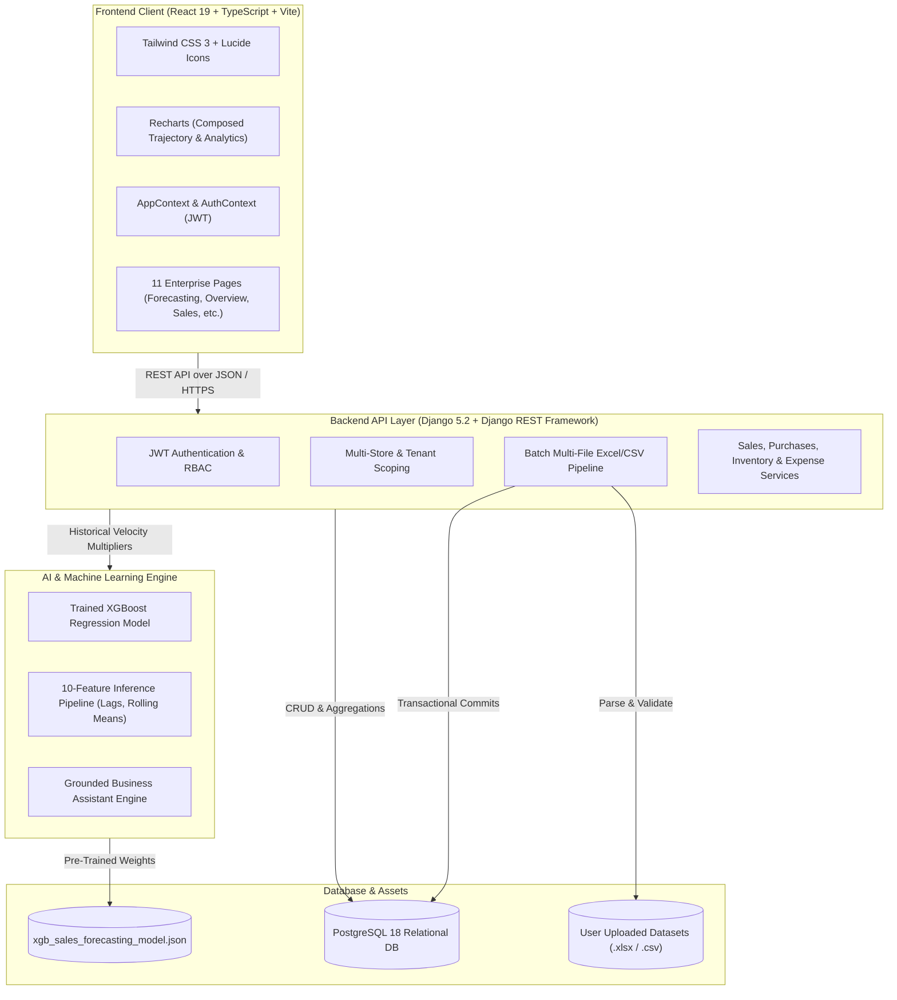

# 🚀 AI-Business-Operations-Manager (NexusOps AI)

> **Enterprise-Grade AI Business Operations, Predictive Demand Forecasting & Multi-Store Inventory SaaS Platform**

[](https://python.org)
[](https://djangoproject.com)
[](https://postgresql.org)
[](https://react.dev)
[](https://typescriptlang.org)
[](https://tailwindcss.com)
[](https://xgboost.readthedocs.io)
[](https://vitejs.dev)

---

## 📌 Executive Summary

**AI-Business-Operations-Manager (NexusOps AI)** is an intelligent, full-stack enterprise resource planning (ERP) and business operations operating system designed for modern multi-location retailers, wholesalers, and e-commerce brands. 

Traditional businesses run on disconnected spreadsheets, causing two expensive failures:
1. **Stockouts & Lost Revenue**: Best-selling items run dry during demand surges because purchase orders were placed too late, exceeding supplier transit lead times.
2. **Dead Inventory & Trapped Capital**: Thousands of rupees remain locked up in slow-moving stock that depreciates on warehouse shelves.

**NexusOps AI** solves this by unifying **Sales, Inventory, Suppliers, and Expenses** into an automated, machine learning-driven operating system. It computes real-time sales run-rates, forecasts future consumer demand with **calibrated XGBoost regression models**, calculates exact stock runway countdowns, and automatically generates purchase orders with single-click ease.

---

## 🌟 Real-World Benefits for Business Owners

* **Eliminate Stockouts**: Proactive runway countdowns (`Depletes in 3.5 Days`) alert managers before stock hits zero, taking into account specific supplier transit days.
* **Release Trapped Working Capital**: Highlights slow movers and overstocked SKUs so businesses avoid buying excess inventory.
* **Unified Catalog Intelligence**: A real-time matrix ranks your entire product catalog by upcoming sales volume and sell-through probability, eliminating the need to click through hundreds of items one-by-one.
* **Instant Supplier Replenishment**: Generate legally compliant Purchase Orders pre-filled with AI-calculated economic order quantities (EOQ) and lead times in one click.
* **Grounded AI Business Assistant**: Business owners can query financial health, top-selling SKUs, and margin health in natural language, with responses strictly verified against live database transactions.
* **Zero Cognitive Fatigue**: Machine learning predictions are translated into plain-English business indicators (*Chance to Sell*, *Share of Store Volume*, *Runway in Days*) rather than confusing data-science jargon.

---

## 🏗️ System Architecture



---

## 🛠️ Technology Stack

| Domain | Technology | Purpose & Role |
| :--- | :--- | :--- |
| **Frontend Framework** | React 19 + TypeScript 5.6 | Single Page Application (SPA) with strict type safety |
| **Build & Tooling** | Vite 6.0 + PostCSS | Blazing fast HMR and optimized production bundling |
| **Styling & Icons** | Tailwind CSS 3.4 + Lucide React | Clean, responsive UI with cohesive light/dark color palette |
| **Data Visualization** | Recharts 2.15 | Interactive demand curves, confidence corridors, and sparklines |
| **Backend Framework** | Python 3.13 + Django 5.2 | High-throughput, battle-tested REST API architecture |
| **API Framework** | Django REST Framework (DRF) | Serializers, viewsets, and OpenAPI 3 schema generation |
| **Authentication** | `djangorestframework-simplejwt` | Stateless JWT token issuance and refresh cycle |
| **Database** | PostgreSQL 18 with `psycopg3` | ACID-compliant relational persistence with indexed foreign keys |
| **Machine Learning** | XGBoost 3.4.1 + NumPy + Pandas | 10-feature demand forecasting regression model |
| **File Processing** | OpenPyXL 3.1 + Python CSV | Real-time multi-file Excel/CSV streaming and parsing |
| **API Documentation** | drf-spectacular (OpenAPI 3 / Swagger) | Interactive API exploration at `/api/docs/` |

---

## 🎯 Key Application Modules

### 1. 📈 Unified AI Demand Forecasting & Replenishment
* **Store-Wide Executive Pulse**: Summarizes total catalog demand across 7-day or 14-day horizons, projected gross revenue (₹), and total stockout exposure.
* **Catalog Sales Probability & Demand Matrix**: Automatically ranks every product in the catalog by upcoming sales volume and statistical sell-through probability:
  $$P(\text{Sale}) = 1 - e^{-\lambda} \quad (\lambda = \text{Daily Velocity} \times \text{Horizon Days})$$
* **Interactive Demand Trajectory Chart**: Displays actual past customer sales bills alongside forward-looking AI model predictions with a **90% confidence corridor**.
* **Unclipped Reference Line**: Marks the exact transition point (*Last Bill Date*) with a clean, high-contrast SVG badge.
* **Automated 1-Click Purchase Order Generation**: Detects stockout risks, factors in supplier transit lead times, and pre-fills PO modals with the exact required quantity.

### 2. 📊 Executive Overview Dashboard
* **Real-Time KPIs**: Total Revenue, Units Sold, Total Operating Expenses, Gross Profit, Inventory Valuation, and Low-Stock Alert counts.
* **Filterable Analytics**: Dynamically adjusts metrics for *All Time*, *12 Months*, *30 Days*, *7 Days*, or *24 Hours*.
* **Location Filtering**: Toggle between consolidated pan-India metrics or specific flagship stores (Mumbai, Bengaluru, Delhi, Hyderabad).

### 3. 📦 Inventory & SKU Management
* Real-time stock counts, category filtering, unit costs vs. retail selling prices.
* Automatic status classification: `In Stock`, `Low Stock`, or `Out of Stock`.
* Multi-warehouse valuation and reorder threshold monitoring.

### 4. 🚚 Purchases & Supplier Intelligence
* Supplier directory tracking vendor lead times (days), reliability scores, and contact information.
* Purchase order management with payment status (`Unpaid`, `Paid`) and fulfillment tracking (`Pending`, `Received`).

### 5. 💸 Expense Ledger & Cost Accounting
* Categorized operational spend (COGS, Logistics, Payroll, Rent, Utilities, Marketing).
* Margin health analytics showing operating expense ratios relative to collected revenue.

### 6. 🤖 Grounded AI Business Assistant
* Natural language chat interface answering operational questions (e.g., *"What is my best-selling SKU this month?"*, *"Which supplier has the longest transit delay?"*).
* Strictly grounded in database records to prevent hallucinations.

### 7. 📥 Multi-File Batch Data Pipeline
* Upload custom user spreadsheets (`.xlsx` or `.csv`) for Sales, Inventory, Purchases, Suppliers, and Expenses.
* **Topological Dependency Resolution**: Automatically imports tables in the correct relational order (Suppliers $\rightarrow$ Inventory $\rightarrow$ Purchases $\rightarrow$ Sales $\rightarrow$ Expenses).
* Complete rollbacks on failure using atomic database transactions (`transaction.atomic()`).

---

## 📂 Repository Directory Structure

```text
AI-Business-Operations-Manager/
├── Frontend/                           # React 19 + TypeScript + Vite SPA
│   ├── public/
│   │   ├── default-avatar.png          # Production user profile avatar
│   │   └── favicon.svg                 # Application favicon
│   ├── src/
│   │   ├── assets/                     # Logos and static vector graphics
│   │   ├── components/
│   │   │   ├── imports/                # Multi-File Drag-and-Drop modal
│   │   │   ├── layout/                 # Sidebar, TopNavbar, AppLayout
│   │   │   └── ui/                     # MetricCard, StatusBadge, Modal, Toast
│   │   ├── context/                    # AppContext (Data) & AuthContext (JWT)
│   │   ├── pages/                      # 11 Full-Featured Dashboard Pages
│   │   │   ├── Overview.tsx            # Executive KPI & Sales Pulse
│   │   │   ├── Forecasting.tsx         # Unified AI Demand Forecasting
│   │   │   ├── Inventory.tsx           # Catalog & Stock Monitoring
│   │   │   ├── Sales.tsx               # Point of Sale & Receipt Ledger
│   │   │   ├── Purchases.tsx           # Supplier PO Management
│   │   │   ├── Expenses.tsx            # Operating Expenditure Ledger
│   │   │   ├── Analytics.tsx           # Financial P&L Breakdown
│   │   │   ├── Assistant.tsx           # Conversational AI Operations Lead
│   │   │   ├── Recommendations.tsx     # Rule-Based Operational Advice
│   │   │   ├── Reports.tsx             # Audit Reports & Data Export
│   │   │   └── Settings.tsx            # Multi-Store & Profile Config
│   │   ├── types/                      # TypeScript domain definitions
│   │   └── lib/                        # API client & INR currency formatters
│   ├── package.json
│   └── vite.config.ts
├── backend/                            # Django 5.2 REST Framework API
│   ├── manage.py
│   ├── config/                         # Settings, ASGI/WSGI, Root URLs
│   ├── apps/
│   │   ├── accounts/                   # Authentication, User Model & Roles
│   │   ├── businesses/                 # Multi-Tenant Business & Store Scoping
│   │   ├── sales/                      # Invoicing & Customer Transactions
│   │   ├── inventory/                  # Products, Categories & Valuation
│   │   ├── purchases/                  # Suppliers & Purchase Orders
│   │   ├── expenses/                   # Operational Expense Tracking
│   │   ├── forecasting/                # XGBoost Service & Predictors
│   │   ├── analytics/                  # Financial Summaries & Aggregates
│   │   ├── assistant/                  # Grounded AI Chat Assistant
│   │   └── imports/                    # Transactional Multi-File Import Engine
│   ├── requirements.txt                # Python Backend Dependencies
│   └── .env.example                    # Environment Variables Template
├── ML_MODEL/
│   ├── xgb_sales_forecasting_model.json# Trained XGBoost Machine Learning Model
│   └── feature_columns.json            # 10 Engineered Model Feature Names
├── datasets/                           # Verified Sample Datasets for Testing
│   ├── sales.xlsx                      # 1,200+ Transactional Billing Receipts
│   ├── inventory.xlsx                  # Catalog SKUs with Stocks & Costs
│   ├── suppliers.xlsx                  # Suppliers with Transit Lead Times
│   ├── purchases.xlsx                  # Historic Purchase Orders
│   └── expenses.xlsx                   # Operating Expenditures
├── .gitignore                          # Bulletproof Git Protection
└── README.md                           # Documentation
```

---

## ⚡ Quick Start Guide

### Prerequisites
* **Python**: 3.11, 3.12, or 3.13
* **Node.js**: 18.x, 20.x, or 22.x (with `npm`)
* **PostgreSQL**: 15+ (or SQLite fallback for quick evaluation)

---

### 1. Backend Setup

```powershell
# 1. Clone repository
git clone https://github.com/nishant-mazumder/AI-Business-Operations-Manager.git
cd AI-Business-Operations-Manager/backend

# 2. Create and activate virtual environment
python -m venv venv
.\venv\Scripts\Activate.ps1    # On Windows PowerShell
# source venv/bin/activate     # On macOS/Linux

# 3. Install backend dependencies
pip install -r requirements.txt

# 4. Configure environment variables
copy .env.example .env
# Edit .env to set your database credentials and secret key

# 5. Apply database migrations
python manage.py migrate

# 6. Start the Django development server
python manage.py runserver
```

Backend will be live at: **`http://127.0.0.1:8000/`**  
Interactive OpenAPI/Swagger docs: **`http://127.0.0.1:8000/api/docs/`**

---

### 2. Frontend Setup

```powershell
# Open a new terminal in the Frontend directory
cd AI-Business-Operations-Manager/Frontend

# 1. Install frontend dependencies
npm install

# 2. Launch Vite development server
npm run dev
```

Frontend will be live at: **`http://localhost:5173/`**

---

## 🔑 Default Credentials for Quick Demo

| Field | Demo Credential |
| :--- | :--- |
| **Email** | `aarav.sharma@nexusops.in` |
| **Password** | `StrongPassword@2026` |
| **Role** | Director of Operations |
| **Flagship Stores** | Mumbai Flagship (`MUM-BKC`), Bengaluru Tech Hub (`BLR-IND`), Delhi NCR Hub (`DEL-CYB`), Hyderabad Cyberabad (`HYD-HIT`) |

---

## 🧪 Testing the Live Import Pipeline

To test the multi-file import system using real data:
1. Open the application at `http://localhost:5173`.
2. Click **"Import Data"** in the top navbar.
3. Drag & drop all 5 Excel files from the [`datasets/`](file:///C:/Users/acer/OneDrive/Desktop/AI-Business-Operations-Manager/datasets) directory:
   * `suppliers.xlsx`
   * `inventory.xlsx`
   * `purchases.xlsx`
   * `sales.xlsx`
   * `expenses.xlsx`
4. Inspect the row-level preview and click **"Commit Import"**.
5. All dashboards, charts, and forecasts will immediately recalculate using 100% of the newly imported records.

---

## 🛡️ License & Acknowledgements

Developed as an **Enterprise Capstone Project** by **Nishant Mazumder**.  
Built with Python, Django, PostgreSQL, React, and XGBoost. All rights reserved.
