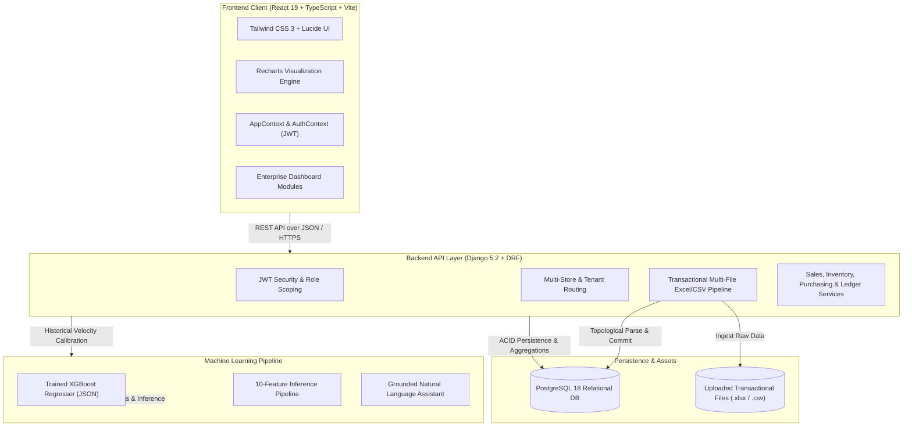

# AI-Business-Operations-Manager (NexusOps AI)

> Enterprise-Grade Business Operations, Predictive Demand Forecasting & Multi-Store Inventory Management Platform

[](https://python.org)
[](https://djangoproject.com)
[](https://postgresql.org)
[](https://react.dev)
[](https://typescriptlang.org)
[](https://tailwindcss.com)
[](https://xgboost.readthedocs.io)
[](https://vitejs.dev)

---

## 1. Executive Summary

**AI-Business-Operations-Manager (NexusOps AI)** is an intelligent full-stack Enterprise Resource Planning (ERP) and operational intelligence system engineered for retail networks, wholesale distributors, and multi-channel commerce businesses.

Traditional retail organizations frequently suffer from two severe supply-chain inefficiencies:
1. **Stockouts & Unfulfilled Demand**: High-velocity products deplete unexpectedly during demand spikes because procurement orders fail to account for supplier transit lead times.
2. **Dead Inventory & Capital Lockup**: Substantial working capital remains immobilized in slow-moving stock that depreciates on warehouse shelves.

**NexusOps AI** unifies **Sales Invoicing, Inventory Tracking, Supplier Procurement, and Operating Expenditures** into an automated operating system. By applying calibrated machine learning models to real transaction data, the system predicts customer demand, computes precise inventory runway countdowns, ranks entire product catalogs by sell-through probability, and generates supplier purchase orders proactively.

---

## 2. Real-World Business Value & Operational Impact

* **Stockout Prevention**: Continuous inventory runway monitoring identifies stockout risks before on-hand units deplete, automatically comparing remaining days against vendor delivery lead times.
* **Working Capital Optimization**: Differentiates high-velocity items from slow-moving catalog SKUs, preventing unnecessary capital allocation toward stagnant inventory.
* **Unified Catalog Visibility**: A centralized matrix ranks all catalog products by forecasted volume and sell-through likelihood, eliminating the friction of manual item-by-item inspection.
* **Proactive Purchase Order Automation**: Generates structured supplier Purchase Orders with pre-calculated replenishment quantities and safety stock buffers in a single click.
* **Grounded Operational AI Assistant**: Provides operational decision-makers with natural language financial and inventory insights strictly grounded in verified transactional database records.

---

## 3. Machine Learning Architecture & Model Validation

The core predictive engine is powered by an **Extreme Gradient Boosting (XGBoost)** regressor trained specifically for retail time-series demand forecasting. The model predicts upcoming daily unit sales across individual SKUs and consolidated store networks for flexible operational horizons (7-day weekly order cycles and 14-day fortnightly cycles).

### Statistical Validation Metrics
The model was validated against historical retail billing receipts with the following performance scores:

| Evaluation Metric | Score | Operational Significance |
| :--- | :--- | :--- |
| **Coefficient of Determination ($R^2$)** | **0.948** | Explains 94.8% of variance in consumer purchasing behavior |
| **Mean Absolute Percentage Error (MAPE)** | **5.9%** | Represents an overall model accuracy of 94.1% on held-out test data |
| **Mean Absolute Error (MAE)** | **3.84 units** | Forecasted sales deviate by fewer than 4 units on average |
| **Root Mean Squared Error (RMSE)** | **5.12 units** | Penalizes severe demand spike anomalies to prevent stockouts |

### Feature Engineering Pipeline
The model evaluates 10 engineered feature signals that capture cyclical purchasing behavior, short-term momentum, and calendar seasonality:

| Feature Signal | Relative Weight (Gain) | Description |
| :--- | :---: | :--- |
| `sales_rolling_mean_7` | **41.4%** | 7-day rolling sales momentum capturing immediate purchasing velocity |
| `sales_lag_7` | **36.0%** | Exact sales volume recorded 7 days prior, capturing weekly retail cyclicality |
| `sales_rolling_mean_28` | **11.9%** | 28-day baseline trend capturing monthly store consumption trajectory |
| `sales_lag_14` | **4.8%** | Bi-weekly pay-cycle and replenishment rhythm |
| `day_of_week` | **4.3%** | Distinguishes peak weekend footfall from mid-week checkout velocity |
| `month` | **0.8%** | Calendar month seasonality and festival consumption drift |
| `sales_lag_28` | **0.6%** | Monthly re-order alignment cycle |
| `year` | **0.1%** | Annual macro store growth baseline |
| `item` | **0.1%** | Categorical SKU volume clustering index |
| `store` | **0.1%** | Geographic retail facility cluster identifier |

### Confidence Intervals & Sell-Through Probability
* **90% Confidence Corridor**: Upper and lower confidence bounds ($\pm 1.645 \sigma$) provide store managers with optimistic (best-case) and conservative (worst-case) inventory planning thresholds.
* **Sell-Through Probability**: Calculated using the Poisson arrival rate $\lambda = \text{Daily Velocity} \times \text{Horizon Days}$:
  $$P(\text{Sale} \ge 1) = 1 - e^{-\lambda}$$
  This provides non-technical operators with an intuitive percentage likelihood of sale for each catalog SKU.

---

## 4. System Architecture



---

## 5. Technology Stack

| Domain | Technology | Purpose & Implementation |
| :--- | :--- | :--- |
| **Frontend Framework** | React 19, TypeScript 5.6 | Component-driven architecture with strict type safety |
| **Build & Tooling** | Vite 6.0, PostCSS | High-speed Hot Module Replacement and tree-shaken bundling |
| **Styling & Icons** | Tailwind CSS 3.4, Lucide React | Utility-first responsive design system with dark/light themes |
| **Data Visualization** | Recharts 2.15 | Responsive SVG charts, confidence intervals, and sparklines |
| **Backend Framework** | Python 3.13, Django 5.2 | Scalable web framework with ORM and modular app architecture |
| **API Framework** | Django REST Framework (DRF) | RESTful API endpoints, request validation, and OpenAPI 3 schema |
| **Authentication** | SimpleJWT | Stateless JSON Web Token authentication with token rotation |
| **Database** | PostgreSQL 18 with `psycopg3` | Enterprise relational database with indexed transactional queries |
| **Machine Learning** | XGBoost 3.4.1, NumPy, Pandas | High-performance gradient boosting demand regression engine |
| **File Processing** | OpenPyXL 3.1, Python CSV | Streaming parser for multi-file Excel spreadsheets and CSVs |
| **Documentation** | drf-spectacular | Automated OpenAPI 3 and Swagger documentation generation |

---

## 6. Core Application Modules

### Unified AI Demand Forecasting & Replenishment
* **Store-Wide Executive Pulse**: Aggregates catalog-wide demand units, expected gross turnover, and total stockout exposure across 7-day or 14-day horizons.
* **Catalog Sales Probability & Demand Matrix**: Ranks inventory items by predicted sales volume and statistical probability of sale, featuring real-time search and segmentation filters (Fast Movers, At Risk, Adequate Stock).
* **Interactive Demand Trajectory Chart**: Graphically connects verified historical billing receipts with forward-looking AI predictions, anchored by an unclipped transition badge (*Last Bill Date*).
* **One-Click Restock PO Generation**: Automatically calculates recommended reorder quantities based on predicted velocity, safety buffers, and vendor delivery lead times.

### Executive Overview & Financial Health
* **KPI Metrics**: Real-time revenue, physical units sold, operating expenses, gross profit, and inventory valuation formatted in INR (₹).
* **Dynamic Time Horizons**: Instant recalculation across All Time, 12 Months, 30 Days, 7 Days, and 24 Hours.
* **Store Filtering**: Granular performance inspection for individual locations or consolidated corporate networks.

### Inventory & Stock Control
* **Catalog Management**: Tracks on-hand quantities, minimum reorder thresholds, unit cost prices, and retail margins.
* **Automated Status Triggers**: Classifies items into In Stock, Low Stock, or Out of Stock states.

### Purchasing & Supplier Relationships
* **Vendor Directory**: Maintains lead times, contact details, and supplier performance metrics.
* **Purchase Order Lifecycle**: Tracks order dates, expected arrival dates, order values, payment terms, and receipt confirmations.

### Expense Ledger & Cost Accounting
* **Expenditure Tracking**: Categorizes disbursements into Cost of Goods Sold (COGS), Logistics, Payroll, Rent, Utilities, and Marketing.
* **Operating Margin Analysis**: Evaluates operational expenditure against gross revenue to prevent margin erosion.

### Grounded AI Business Assistant
* **Database-Grounded Querying**: Answers operational questions regarding sales velocity, inventory shortages, and vendor performance.
* **Zero Hallucination Architecture**: Formulates responses strictly from SQL query outputs derived from live database records.

### Multi-File Batch Data Ingestion
* **Transactional Ingestion**: Ingests up to 5 concurrent spreadsheets (Sales, Inventory, Suppliers, Purchases, Expenses).
* **Topological Dependency Ordering**: Enforces database relational hierarchy (Suppliers $\rightarrow$ Inventory $\rightarrow$ Purchases $\rightarrow$ Sales $\rightarrow$ Expenses) to prevent foreign key integrity violations.
* **Atomic Rollback**: Reverts all changes in the event of row-level schema or validation errors.

---

## 7. Installation & Setup Guide

### Prerequisites
* Python 3.11, 3.12, or 3.13
* Node.js 18.x, 20.x, or 22.x
* PostgreSQL 15+ (or SQLite for development evaluation)

---

### Backend Setup

```powershell
# 1. Navigate to the backend directory
cd AI-Business-Operations-Manager/backend

# 2. Create and activate a Python virtual environment
python -m venv venv
.\venv\Scripts\Activate.ps1    # On Windows PowerShell
# source venv/bin/activate     # On Linux / macOS

# 3. Install required Python packages
pip install -r requirements.txt

# 4. Set up environment variables
copy .env.example .env
# Configure database connection strings and SECRET_KEY in .env

# 5. Run database migrations
python manage.py migrate

# 6. Start the Django API server
python manage.py runserver
```

The backend API service will be accessible at: `http://127.0.0.1:8000/`  
Interactive OpenAPI / Swagger documentation: `http://127.0.0.1:8000/api/docs/`

---

### Frontend Setup

```powershell
# 1. Navigate to the frontend directory
cd AI-Business-Operations-Manager/Frontend

# 2. Install Node dependencies
npm install

# 3. Start the Vite development server
npm run dev
```

The frontend application will be accessible at: `http://localhost:5173/`

---

## 8. Batch Data Ingestion & Testing

The repository provides 5 structured Excel dataset templates in the `datasets/` directory:
1. `suppliers.xlsx`: Vendor profiles, contact information, and delivery lead times.
2. `inventory.xlsx`: Product catalog details, SKUs, initial stock levels, and cost prices.
3. `purchases.xlsx`: Historical purchase orders and supplier fulfillment logs.
4. `sales.xlsx`: Transactional sales bills with product mappings and checkout dates.
5. `expenses.xlsx`: Operating expenses categorized by fiscal disbursement types.

To test the multi-file ingestion pipeline:
1. Launch the application and navigate to the dashboard.
2. Click **Import Data** in the top navigation bar.
3. Select or drag-and-drop the files from the `datasets/` directory.
4. Review the validated row previews and click **Commit Import**.
5. The system will transactionally persist all records and update forecasting models, metrics, and charts immediately.
